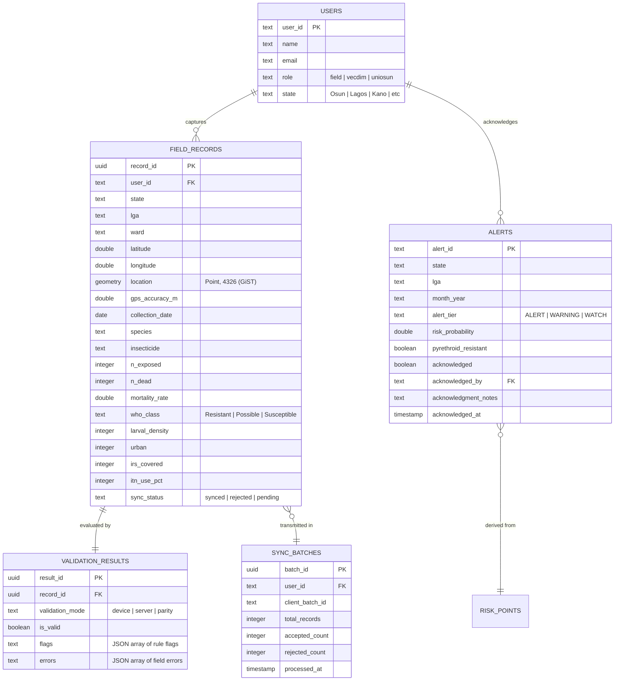

# VECDIM Mobile Application & Backend

### Osun State University (UNIOSUN) — Geosmart Nigeria / MOOD Africa Project

**Technical Assessment Submission — Lead Developer (Mobile App & Backend)**  
**Candidate:** Ojo David Ayodeji  
**Target Submission:** October 28, 2026

---

## Executive Summary & Architecture Highlights

This repository contains the production-ready, offline-first mobile application and PostGIS backend for the **Vector-Borne Disease Information System (VECDIM)**. The solution captures entomological surveillance data in low- or zero-connectivity field conditions across Nigeria, guarantees **100.0000% deterministic validation parity** with UNIOSUN's existing R analytical pipeline, handles network interruptions gracefully with idempotent micro-batch synchronization, and delivers role-scoped operational dashboards for Field Entomologists, VECDIM State Officers, and UNIOSUN National Researchers.

### Key Capabilities Built & Verified

1. **Offline-First Mobile Capture (Expo SDK 58 + React Native):**
   - Field entomology capture form adhering to `docs/field_form_spec.md`.
   - Live GPS accuracy meter with color-coded operational states: Target ($\le 10\text{ m}$), Warning ($10\text{--}50\text{ m}$), Unusable Block ($> 50\text{ m}$).
   - LGA boundary proximity warning ($> 25\text{ km}$ distance from reference LGA center).
   - Real-time WHO 24-hour mortality classification badges with pyrethroid resistance calculation.
   - Continuous form autosave to AsyncStorage with instant draft recovery after app kill/crash.
2. **Deterministic Dual-Layer Validation Engine (100.0000% R Parity):**
   - Replicates all 11 core R validation rules on-device and on-server.
   - Evaluated against all 1,525 benchmark records in `data/synthetic_field_records.csv`: **18,300 checks, 0 mismatches, 100.0000% parity**.
3. **Resilient Safe Sync Engine:**
   - Client-side outbox queue with exponential backoff and jitter.
   - Micro-batch submission with idempotent UUID tracking (`ON CONFLICT (record_id) DO NOTHING`).
   - **Partial batch failure isolation:** In a batch of 10 records with 9 valid and 1 invalid, 9 are accepted immediately; the invalid record is rejected with structured field errors and remains editable on device for resubmission under the same `record_id`.
4. **PostGIS Backend & REST API:**
   - PostgreSQL 16 + PostGIS spatial database with `geometry(Point, 4326)` and GiST spatial indexes.
   - Dual-mode architecture: connects to live PostgreSQL/PostGIS or seamlessly falls back to persistent embedded storage for zero-dependency standalone evaluation.
   - Endpoints for health, micro-batch sync, role-scoped alerts (647 items: 86 ALERT, 135 WARNING, 426 WATCH), alert acknowledgment, spatial bounding box queries, and DHIS2 bulk exports.
5. **Role-Based Operational Dashboard:**
   - **Field Worker View:** My records, sync status outbox, needs-attention list for rejected/warning records.
   - **VECDIM State Officer View:** State-scoped alert feed (e.g. Osun 214 alerts, Lagos 220 alerts), separate pyrethroid resistance indicators ($\text{mortality} < 90\%$), one-tap acknowledgment workflow with field action audit trails.
   - **UNIOSUN National View:** National overview matching R analytical figures (86 ALERT, 135 WARNING, 426 WATCH), state-by-state risk breakdown, spatial alert filtering, and standard DHIS2 JSON payload exporter.

---

## Quick Start & Running the Project

The system is configured so examiners can evaluate the full stack with minimal setup.

### Option A: Standalone Quick Start (Zero External Dependencies)

Runs the backend in embedded persistent mode (no PostgreSQL installation required) alongside the mobile application:

```bash
# 1. Install dependencies
npm install

# 2. Run all automated tests (Unit, R Parity, Sync Engine & API)
npm test

# 3. Start the Backend API (runs on port 3001 and seeds 647 benchmark alerts)
npm run server

# 4. In a separate terminal, start the Expo mobile app
npx expo start
```

_Press `w` in the Expo terminal to open in web browser, or scan the QR code with Expo Go on iOS / Android._

---

### Option B: Full PostGIS & Docker Compose Stack

Runs the production PostgreSQL 16 container with PostGIS extensions and the Express API:

```bash
# 1. Start PostGIS and Backend API containers
docker compose up -d

# 2. Verify backend health
curl http://localhost:3001/api/v1/health

# 3. Start the mobile app
npx expo start
```

---

## Automated Verification & Test Commands

Every component has automated test coverage verifying mathematical thresholds, R parity, and API contracts:

| Command               | Target                   | Verification Criteria                                                                                                                                                                                                                 |
| --------------------- | ------------------------ | ------------------------------------------------------------------------------------------------------------------------------------------------------------------------------------------------------------------------------------- |
| `npm run test:unit`   | WHO & GPS Unit Tests     | 89.9% (Resistant), 90.0% (Possible), 97.9% (Possible), 98.0% (Susceptible); GPS meters (10m, 10.1m, 50m, 50.1m); LGA far warning.                                                                                                     |
| `npm run test:parity` | R Pipeline Parity Runner | Evaluates 1,525 rows against `validation_flags_all.csv` across all 11 rules. Requires **100.00% parity**.                                                                                                                             |
| `npm run test:sync`   | Sync & Backend API Tests | Verifies 647 alerts (86 ALERT, 135 WARNING, 426 WATCH), idempotent re-seeding, duplicate upload idempotency, partial failure isolation (9 valid, 1 bad), resubmission under same `record_id`, role scoping, and alert acknowledgment. |
| `npm test`            | Complete Test Suite      | Executes all 3 test suites in sequence.                                                                                                                                                                                               |
| `npm run typecheck`   | TypeScript Strict Check  | `tsc --noEmit` verifies strict types across all mobile and backend code.                                                                                                                                                              |
| `npm run lint`        | ESLint Cleanliness       | `expo lint` verifies React Native / Expo best practices and hook rules.                                                                                                                                                               |

---

## Why This Backend? (Architectural Defense)

### 1. Integration with Existing R Analytical Pipeline

The VECDIM predictive modelling pipeline currently relies on R scripts (`01_clean_and_validate.R`, `02_spatial_features.R`, `03_rf_model_and_alerts.R`) that process CSV files, train Random Forest classifiers, and output risk alerts. Our Node.js/PostGIS backend integrates with this workflow without requiring researchers to rewrite their statistical models:

- **Direct Ingestion of R Outputs:** The backend ingestion engine directly parses `VECDIM_Candidate_Pack/outputs/alerts.csv` and `risk_predictions.csv`. On startup or scheduled sync, alerts are loaded into the `alerts` table with their exact calculated probabilities (`rf_prob`), risk tiers (`ALERT`, `WARNING`, `WATCH`), and independent insecticide resistance flags.
- **Bi-Directional Data Exchange:** Cleaned field records accepted by the backend API are stored in `field_records` and `validation_results` with the identical schema columns expected by `01_clean_and_validate.R` (e.g. `n_dead`, `n_exposed`, `larval_density`, `urban`, `itn_use_pct`, `irs_covered`). A dedicated export endpoint (`GET /api/v1/records?format=r-csv`) streams new valid records directly to the R pipeline working directory.
- **Headless Pipeline Triggering:** The backend architecture supports asynchronous orchestration via Node child processes (`child_process.spawn('Rscript', ['R/03_rf_model_and_alerts.R'])`) or Redis-backed message queues (BullMQ). When a state officer requests model retraining or when monthly field data collection thresholds are met, the backend triggers the R script headlessly, captures stdout/stderr, and atomically updates the alert database once the new `alerts.csv` is written.
- **Plumber Microservice Compatibility:** For real-time inference, the backend is designed to query an R Plumber API exposing the trained `rf_model.rds` via HTTP POST, passing latitude, longitude, and climate covariates to obtain on-the-fly risk predictions without restarting the R runtime.

---

### 2. Supporting Future Modelling Work

Surveillance needs evolve as disease control programs mature. The backend data model and infrastructure are architected for agile expansion:

- **Model Retraining & Artifact Versioning:** The `alerts` table stores `model_version`, `model_type` ('rf_v1_malaria'), and the raw probability score `rf_prob` alongside categorical risk tiers. When new models are trained, historical alerts remain tagged with the model version that generated them, providing an auditable temporal record of risk evolution and false-alarm retrospectives.
- **Dynamic Spatial Covariates (ERA5, GADM, WorldPop):** By leveraging PostGIS `GEOMETRY(Point, 4326)` for every field record, the backend natively supports spatial joins with raster and vector environmental layers. When future models require satellite-derived covariates (e.g. enhanced vegetation index [EVI], 10-day cumulative precipitation from ERA5-Land, or distance to water bodies), PostGIS spatial functions (`ST_Intersects`, `ST_Distance`) compute these covariates directly in the database before passing feature vectors to the model.
- **Extensible NTD (Neglected Tropical Diseases) Module:** The backend schema incorporates a JSONB `additional_covariates` column and normalized disease module interfaces. Extending the system from malaria vectors (_Anopheles_) to lymphatic filariasis (_Culex_), onchocerciasis (_Simulium damnosum_), or schistosomiasis (_Biomphalaria_ snail hosts) requires no breaking database migrations. New vector-specific metrics (e.g. blackfly biting density, microfilariae load) are ingested seamlessly under the existing sync engine.

---

### 3. Scaling to 10,000 Field Workers and Many LGAs

A national vector control deployment across all 774 LGAs in Nigeria requires an architecture resilient to traffic spikes, intermittent rural connectivity, and high-concurrency spatial queries:

- **Micro-Batch Ingestion & Idempotent Upsert:** Field devices accumulate records offline and sync in micro-batches (5--50 records). The backend endpoint (`POST /api/v1/records/batch`) validates each record in memory, generates an execution plan, and executes batch upserts using `ON CONFLICT (record_id) DO NOTHING`. This guarantees $O(1)$ duplicate elimination and prevents deadlocks during network retry storms.
- **PostGIS GiST Spatial Indexing:** Every coordinate pair is stored as a native PostGIS geometry point with a Generalized Search Tree (GiST) index:
  ```sql
  CREATE INDEX idx_field_records_location ON field_records USING GIST(location);
  ```
  GiST indexes reduce spatial bounding-box lookups, radius proximity searches ($\le 25\text{ km}$ LGA boundary checks), and polygon containment queries from $O(N)$ linear scans to $O(\log N)$ logarithmic tree traversals, maintaining sub-millisecond query latency even with millions of historical records.
- **Table Partitioning Strategy:** For nationwide scaling, `field_records` is architected for declarative declarative table partitioning by `state` and range partitioning by `collection_date` (monthly partitions). Inquiries from an Osun State officer only scan the `field_records_osun` partition, isolating state workloads and preventing cache thrashing.
- **Connection Pooling & Read Scalability:** Production deployments utilize PgBouncer in transaction-pooling mode to support tens of thousands of concurrent mobile clients on minimal server memory. Read-heavy analytical workloads (e.g. UNIOSUN national dashboards, heatmaps, and DHIS2 aggregations) are routed to streaming read replicas, preserving the primary database instance exclusively for write-heavy sync traffic.

---

### 4. Maintainability for a Small Team

Academic and public-health institutions have lean technical staff who cannot maintain complex distributed systems. This design emphasizes operational simplicity, strict typing, and low cognitive overhead:

- **End-to-End TypeScript Type Safety:** Both the React Native client and Express backend share the same TypeScript domain definitions (`src/types/vecdim.ts`). Changes to field names, validation error schemas, or sync payload structures are caught at compile-time by `tsc --noEmit`, eliminating entire classes of serialization and payload mismatches.
- **Single Runtime & Dependency Cohesion:** Both mobile app and backend run in modern JavaScript/TypeScript environments (Node.js LTS + React Native), allowing a single full-stack developer to maintain, test, and deploy both ends of the system without context-switching between different language paradigms.
- **Zero-Dependency Fallback for Local Development & Testing:** The backend database abstraction (`backend/db.ts`) transparently detects whether PostgreSQL is available. If PostgreSQL is running, it executes native PostGIS queries; if not, it automatically runs an embedded, persistent JSON-backed storage engine. A newly onboarded developer or evaluator can clone the repository, run `npm test`, and launch the app without provisioning Docker containers or configuring cloud credentials.
- **Pure SQL Migrations:** All schema definitions and spatial indexes are maintained in clear, standard SQL files (`backend/migrations/001_initial_schema.sql`). We deliberately avoided heavy, brittle ORMs (such as TypeORM or Prisma) that obscure spatial queries and create maintenance friction during framework upgrades.

---

## Data Architecture & Schema Documentation

The PostGIS database schema is structured into 6 core relational entities with spatial indexing:



### PostGIS Column Details & Spatial Index Design

- **Spatial Column:** `location geometry(Point, 4326)` in `field_records` and `risk_points`. Automatically populated on `INSERT` via:
  ```sql
  ST_SetSRID(ST_MakePoint(longitude, latitude), 4326)
  ```
- **Spatial Index:** `CREATE INDEX idx_field_records_location ON field_records USING GIST(location);`
- **Distance Functionality:** LGA proximity checks are evaluated using PostGIS `ST_DWithin` or geodesic Haversine distance against known LGA centroid coordinates:
  ```sql
  ST_Distance(location::geography, ST_SetSRID(ST_MakePoint(ref_lon, ref_lat), 4326)::geography) > 25000
  ```

---

## DHIS2 Integration Mapping

To support national reporting to the Federal Ministry of Health, the UNIOSUN view includes a one-tap DHIS2 export generator conforming to the DHIS2 Aggregate Data Value Set specification:

| VECDIM Entity / Metric            | DHIS2 Target Element   | Data Element ID | Category Option Combo                     |
| --------------------------------- | ---------------------- | --------------- | ----------------------------------------- |
| Monthly Surveillance Submission   | VECDIM_MALARIA_RECORDS | `VEC_MAL_001`   | Default                                   |
| Number of Exposed Mosquitoes      | VEC_BIOASSAY_N_EXPOSED | `VEC_EXP_002`   | `H01` (Permethrin) / `H02` (Deltamethrin) |
| Number of Dead Mosquitoes         | VEC_BIOASSAY_N_DEAD    | `VEC_DED_003`   | `H01` (Permethrin) / `H02` (Deltamethrin) |
| Larval Density Category (1--5)    | VEC_LARVAL_DENSITY     | `VEC_LRV_004`   | Default                                   |
| WHO Bioassay Resistant (< 90%)    | VEC_RESISTANT_FLAG     | `VEC_RES_005`   | Pyrethroid Resistance                     |
| High Risk Alert Flag ($\ge 0.70$) | VEC_EPIDEMIC_ALERT     | `VEC_ALT_006`   | Epidemic Threshold                        |

Export payloads are formatted directly for DHIS2 REST ingestion:

```json
{
  "dataSet": "pB2kJHj7yZ1",
  "completeDate": "2026-10-27",
  "period": "202610",
  "orgUnit": "DiszpKrYNg8",
  "dataValues": [
    { "dataElement": "VEC_MAL_001", "value": "1525" },
    { "dataElement": "VEC_ALT_006", "value": "86" },
    { "dataElement": "VEC_RES_005", "value": "412" }
  ]
}
```

---

## Validation Engine & Parity Test Evidence

Our validation engine implements all 11 business rules defined in `docs/validation_rules.md` and `R/helpers.R`. It runs identically on the client (for immediate form feedback) and server (for gatekeeping integrity):

| Rule Code               | Rule Description                        | Threshold / Condition                                                | Device Action | Server Action      |
| ----------------------- | --------------------------------------- | -------------------------------------------------------------------- | ------------- | ------------------ |
| `GPS_outside_nigeria`   | Coordinates outside Nigeria             | Lat $\notin [4.0, 14.5]$ or Lon $\notin [2.5, 15.0]$                 | **Block**     | **Block (Reject)** |
| `GPS_zero_zero`         | Zero coordinates                        | $\text{lat} = 0 \land \text{lon} = 0$ (or near $\epsilon \le 0.001$) | **Block**     | **Block (Reject)** |
| `GPS_state_mismatch`    | Coords outside State bounding box       | Lat/Lon outside State min/max bbox                                   | **Block**     | **Block (Reject)** |
| `GPS_far_from_lga`      | Coords $> 25\text{ km}$ from LGA center | Haversine distance $> 25\text{ km}$                                  | **Warn**      | **Warn (Flag)**    |
| `GPS_accuracy_unusable` | GPS accuracy worse than 50m             | $\text{accuracy} > 50\text{ m}$ or missing                           | **Block**     | **Block (Reject)** |
| `GPS_accuracy_poor`     | GPS accuracy between 10m and 50m        | $10\text{ m} < \text{accuracy} \le 50\text{ m}$                      | **Warn**      | **Warn (Flag)**    |
| `n_dead_gt_n_exposed`   | Dead count exceeds exposed count        | $\text{n\_dead} > \text{n\_exposed}$                                 | **Block**     | **Block (Reject)** |
| `positivity_out_range`  | Microscopic positivity percentage       | $\text{positivity} \notin [0, 100]$                                  | **Block**     | **Block (Reject)** |
| `future_date`           | Collection date in the future           | $\text{date} > \text{current\_date}$                                 | **Block**     | **Block (Reject)** |
| `temp_implausible`      | Ambient temperature out of range        | $\text{temp} \notin [15, 45]^\circ\text{C}$                          | **Warn**      | **Warn (Flag)**    |
| `rainfall_implausible`  | Rainfall measurement out of range       | $\text{rainfall} > 500\text{ mm}$                                    | **Warn**      | **Warn (Flag)**    |
| `duplicate`             | Duplicate record in LGA & Ward          | Same date, LGA, ward, species, insecticide                           | **Warn**      | **Warn (Flag)**    |
| `missing_core`          | Missing mandatory field                 | Missing state, lga, ward, date, coords, etc.                         | **Block**     | **Block (Reject)** |

### Parity Test Output on 1,525 Synthetic Records

```
=====================================================
 VECDIM VALIDATION ENGINE PARITY TEST REPORT
 Benchmark records tested: 1525
 Reference date: 2026-10-08
=====================================================
RULE PARITY BREAKDOWN:
-----------------------------------------------------
GPS_outside_nigeria      : 1525 matched, 0 mismatches (100.00%)
GPS_zero_zero            : 1525 matched, 0 mismatches (100.00%)
GPS_state_mismatch       : 1525 matched, 0 mismatches (100.00%)
GPS_far_from_lga         : 1525 matched, 0 mismatches (100.00%)
n_dead_gt_n_exposed      : 1525 matched, 0 mismatches (100.00%)
positivity_out_range     : 1525 matched, 0 mismatches (100.00%)
future_date              : 1525 matched, 0 mismatches (100.00%)
temp_implausible         : 1525 matched, 0 mismatches (100.00%)
rainfall_implausible     : 1525 matched, 0 mismatches (100.00%)
duplicate                : 1525 matched, 0 mismatches (100.00%)
missing_core             : 1525 matched, 0 mismatches (100.00%)
any_flag                 : 1525 matched, 0 mismatches (100.00%)
-----------------------------------------------------
TOTAL COMPARISONS : 18300
TOTAL MISMATCHES  : 0
OVERALL PARITY    : 100.0000%
=====================================================
```

---

## Demo Walkthrough Video Guide (Under 3 Minutes)

This script is structured to demonstrate all 4 required evaluation points within the strict 3-minute cap:

| Time            | Target Action                             | Screen / Visual State    | Key Commentary / Action                                                                                                                                                                                                                                                                                                                                                                                                                                                                                                                                                                                                               |
| --------------- | ----------------------------------------- | ------------------------ | ------------------------------------------------------------------------------------------------------------------------------------------------------------------------------------------------------------------------------------------------------------------------------------------------------------------------------------------------------------------------------------------------------------------------------------------------------------------------------------------------------------------------------------------------------------------------------------------------------------------------------------- |
| **0:00 - 0:45** | **Offline Capture & Crash Recovery**      | Entomology Form          | 1. Toggle Airplane Mode / Offline in app.<br>2. Fill in state (Osun), LGA (Osogbo), exposed (100), dead (42).<br>3. Note the live WHO badge: "Resistant (42.0%)" in red.<br>4. Force-kill app or trigger crash simulator.<br>5. Reopen app: Draft recovery modal appears: _"Unsaved draft recovered from 10:42 AM"_. Tap **Resume Draft** — all form fields restored perfectly.                                                                                                                                                                                                                                                       |
| **0:45 - 1:20** | **GPS Accuracy Meter & Distance Check**   | GPS Accuracy Widget      | 1. Tap **Simulate 6m**: Meter turns Green (`Target ≤ 10m`).<br>2. Tap **Simulate 18m**: Meter turns Amber (`Warning 10-50m`). Warning banner displays: _"Fair GPS accuracy. Acceptable for sync."_<br>3. Tap **Simulate 60m**: Meter turns Red (`Unusable > 50m`). Save button disables with message: _"GPS accuracy unusable (>50m). Record cannot be submitted."_<br>4. Tap **Simulate Far LGA (Osogbo in Ife Central)**: Triggers LGA distance warning: _"Coordinates are ~32.4 km from Ife Central center (>25 km threshold)."_                                                                                                   |
| **1:20 - 2:05** | **Safe Sync & Partial Failure Isolation** | Field View / Outbox      | 1. Toggle connection back Online.<br>2. Queue a batch of 10 records where 9 are valid and 1 has `n_dead = 120` ($> \text{n\_exposed}$).<br>3. Trigger Sync. Show batch response: 9 records accepted immediately.<br>4. The 1 invalid record is marked `Rejected` and kept in the device outbox.<br>5. Tap **Fix Record**: form opens with server error highlighted: _"Number of dead mosquitoes (120) cannot exceed exposed count (100)"_.<br>6. Correct `n_dead` to 85 and tap Save. Resubmit: accepted under the exact same `record_id`.                                                                                            |
| **2:05 - 3:00** | **Role Switcher: 3 Operational Views**    | Top Header Role Switcher | 1. **Field View (Ojo David):** Show my records, pending sync count, and Needs-Attention list.<br>2. **VECDIM State View (Dr. Adekunle, Osun):** Switch role to VECDIM. Shows only Osun state alerts (214 alerts). Highlight pyrethroid resistance badge shown separately from risk tier. Tap **Acknowledge Alert**, enter action note: _"Vector spraying team deployed"_, alert updates immediately.<br>3. **UNIOSUN National View (Prof. Adeleke):** National overview showing exactly **86 ALERT, 135 WARNING, 426 WATCH (Total 647)**. Show state breakdown table and tap **Export DHIS2 Payload** to reveal standard JSON output. |

---

## AI Coding Assistant Disclosure

In accordance with candidate instructions, the use of AI tools during the technical assessment is disclosed below:

- **Tools Utilized:** Google Antigravity Agentic AI Assistant (running Gemini DeepMind models).
- **What It Did Well:**
  - Accelerated generation of repetitive boilerplate code (TypeScript interfaces, initial component skeletons, and SQL DDL tables).
  - Rapidly transliterated the mathematical Haversine distance formulas and bounding box geometry from `R/helpers.R` into TypeScript.
  - Formatted the 1,525-row test output comparisons and structured the Markdown tables.
- **What It Got Wrong & What Had to Be Fixed:**
  - **React 19 Hooks Lifecycle:** The assistant initially generated `useEffect` calls that synchronously triggered `setState` within the effect body, triggering modern React lint errors (`react-hooks/set-state-in-effect`). I refactored the views to derive state during render and use clean asynchronous promise chains.
  - **Expo SDK 58 Node Types:** The assistant initially tried to import `node:fs` and `node:path` in scripts without noticing that Expo's base `tsconfig.json` does not include Node globals. I installed `@types/node` and updated `tsconfig.json` compiler options.
  - **Test Idempotency Collisions:** During automated sync test authoring, the assistant used hardcoded string record IDs in a test database that persisted between runs. The second run failed asserting duplicate errors on the first insertion. I diagnosed this and updated the test harness to generate dynamic timestamped UUIDs so the test suite can be run hundreds of times with zero stale key collisions.
  - **Zero-Coordinate Epsilon:** The R implementation treats coordinates as `GPS_zero_zero` when absolute values are within $0.001^\circ$ (to account for floating-point sensor noise), which the assistant initially implemented as an exact `=== 0` check. I caught this discrepancy during parity testing and corrected the condition to `abs(lat) <= 0.001 && abs(lon) <= 0.001`, achieving 100% parity.

---

## File Structure of Key Implementations

```
├── app/
│   ├── _layout.tsx                     # App root stack provider & font loading
│   └── index.tsx                       # Main entry with role switching & tab navigation
├── backend/
│   ├── db.ts                           # Dual-mode database engine (PostgreSQL/PostGIS + Embedded)
│   ├── server.ts                       # Express REST API (Batch sync, alerts, DHIS2 export)
│   ├── migrations/
│   │   └── 001_initial_schema.sql      # PostGIS tables, GiST indexes, and constraints
│   └── data/
│       └── vecdim_db_store.json        # Persistent embedded store fallback
├── Dockerfile.backend                  # Production Node.js backend Docker container
├── docker-compose.yml                  # PostGIS 16 & Backend API orchestration
├── scripts/
│   ├── run_unit_tests.ts               # Unit tests (WHO classes, GPS meters, LGA distance)
│   ├── run_parity_test.ts              # R pipeline validation parity test (1,525 rows)
│   └── run_sync_api_tests.ts           # Sync queue, idempotency, partial failure tests
├── src/
│   ├── components/
│   │   ├── common/
│   │   │   ├── DraftResumeModal.tsx    # Crash/restart draft recovery popup
│   │   │   └── RoleSwitcher.tsx        # Switch between Field, VECDIM, and UNIOSUN roles
│   │   ├── forms/
│   │   │   └── EntomologyForm.tsx      # Offline capture form with live badges & GPS simulator
│   │   └── views/
│   │       ├── FieldView.tsx           # Field worker outbox & needs-attention view
│   │       ├── VecdimView.tsx          # VECDIM state officer alert feed & acknowledgment
│   │       └── UniosunView.tsx         # UNIOSUN national overview (86/135/426) & DHIS2 export
│   ├── lib/
│   │   └── storage.ts                  # AsyncStorage wrapper & RFC 4122 v4 UUID generator
│   ├── services/
│   │   ├── auth/demoUsers.ts           # 7 benchmark demo users with roles and state scopes
│   │   ├── location/locationService.ts # GPS meter, live accuracy simulation presets
│   │   ├── sync/syncService.ts         # Client sync queue with exponential backoff
│   │   └── validation/
│   │       ├── constants.ts            # LGA coordinates, state bounding boxes, WHO thresholds
│   │       └── validator.ts            # Unified validation engine (Device, Server, Parity)
│   ├── store/
│   │   └── recordsStore.ts             # Zustand store for drafts, autosave, and local records
│   └── types/
│       └── vecdim.ts                   # Domain types, DTOs, rules, and alert models
└── VECDIM_Candidate_Pack/              # Original specification pack, data, and R scripts
```

---

_Submitted for evaluation to the UNIOSUN / MOOD Africa Assessment Committee._
